## Hi there 👋, I'm Ahmad

**Data Science & AI Engineer · Technical Entrepreneur · Full-Stack Developer**

I specialize in building high-performance, low-latency AI pipelines, autonomous systems, and scalable web solutions. As the founder of **Brackora**, I bridge the gap between complex programming and practical digital automation.

Lately I've also been getting PS5 software running on PC. I built a launcher for [AnyPS5](https://github.com/boykopovar/AnyPS5) and contribute fixes to its reimplemented PS5 system libraries.

### 🚀 What I do

- **AI & Computer Vision:** developing real-time inference models and tracking systems.
- **Edge Computing:** running local LLMs and optimizing TTS/STT pipelines on constrained hardware.
- **Web Development:** crafting clean, responsive, and robust digital platforms.
- **Systems & emulation:** C++ fixes to AnyPS5, written to match FreeBSD (the PS5's OS base), and tooling around it.

## 🎮 Featured projects

<table>
<tr>
<td width="50%" valign="top">

### [AnyPS5 Launcher](https://github.com/ahmad3a4/AnyPS5-Launcher)
A PS5-style home screen and game library for AnyPS5 on Windows: add a game, press Play. It converts, checks compatibility, and launches, and it stays on the newest AnyPS5 straight from the official repo.

   

</td>
<td width="50%" valign="top">

### [BMO](https://github.com/ahmad3a4/bmo)
A real-time, voice-interactive AI companion with true personality, sub-second latency, and a face that shows its feelings. Inspired by BMO from Adventure Time, running on a Raspberry Pi 5.

  

### [Hopcord](https://github.com/ahmad3a4/hopcord)
An original 2D platformer that runs live inside a Discord voice channel as a Discord Activity. Race whoever else is in the call to the flag.

 

### [ay_os portfolio](https://github.com/ahmad3a4/portfolio)
My portfolio, rebuilt as a fake operating-system desktop.

 

</td>
</tr>
</table>

## 🧩 Open source: AnyPS5

[AnyPS5](https://github.com/boykopovar/AnyPS5) converts PS5 executables into native PC programs and reimplements the PS5's system libraries. My contributions so far:

| | Contribution | Status |
|---|---|---|
| 🔧 | [**#5502**](https://github.com/boykopovar/AnyPS5/pull/5502) `sysctlnametomib`: a missing kernel function that stopped a Java 25 homebrew app from loading. Written to match FreeBSD; verified by a contributor and merged by a maintainer. |  |
| 🔧 | [**#5831**](https://github.com/boykopovar/AnyPS5/pull/5831) Atomic `O_APPEND` writes on Windows: concurrent appends were losing about 1 in 8 lines. Cross-checked by contributors on Windows and Linux, then merged. |  |
| 🔧 | [**#6287**](https://github.com/boykopovar/AnyPS5/pull/6287) The same fix for `fopen`/`freopen` append streams, found through the log of the PS5MC media center, which was losing characters. |  |
| 🐞 | [**#5931**](https://github.com/boykopovar/AnyPS5/issues/5931) Found that closing Syobon Action crashed AnyPS5's exit path, then validated the two fixes on Windows. |  |
| 🎮 | Game bring-up threads: [Java 25 LAN / DNS (#5501)](https://github.com/boykopovar/AnyPS5/discussions/5501), which now starts on AnyPS5, and [Syobon Action (#5932)](https://github.com/boykopovar/AnyPS5/discussions/5932) | |

## 🛠️ Tech stack

## 🐍 Contributions

<picture>
  <source media="(prefers-color-scheme: dark)" srcset="https://raw.githubusercontent.com/ahmad3a4/ahmad3a4/output/github-snake-dark.svg">
  <source media="(prefers-color-scheme: light)" srcset="https://raw.githubusercontent.com/ahmad3a4/ahmad3a4/output/github-snake.svg">
  
</picture>

## 📫 Let's connect

- **LinkedIn:** [ahmad-yaseen-8937942a0](https://www.linkedin.com/in/ahmad-yaseen-8937942a0/)
- **Email:** [ai.ahmad.3a4@gmail.com](mailto:ai.ahmad.3a4@gmail.com)
